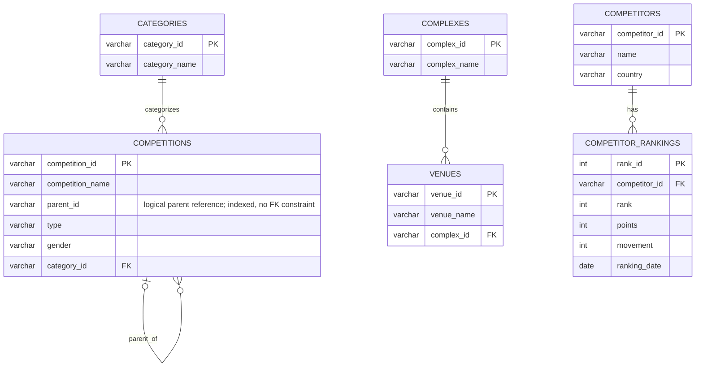

# Database Schema Documentation

## Tennis Sports Analytics

**Database Name:** `tennis_analytics`

**Database Engine:** MySQL 8.0

## 1. Overview

The database stores structured tennis reference information and doubles competitor rankings retrieved from SportRadar APIs.

It contains six tables:

1. categories
2. competitions
3. complexes
4. venues
5. competitors
6. competitor_rankings

## 2. Entity Relationships

The following ER diagram shows the declared foreign-key relationships and the logical competition hierarchy.

Declared foreign keys connect `competitions.category_id` to `categories.category_id`, `venues.complex_id` to `complexes.complex_id`, and `competitor_rankings.competitor_id` to `competitors.competitor_id`. The `competitions.parent_id` column stores the parent competition ID and has an index, but the current schema does not declare it as a foreign key.

## 3. Table Structures

### 3.1 categories

Stores competition categories.

| Column | Data Type | Constraint |
|---|---|---|
| category_id | VARCHAR(50) | Primary Key |
| category_name | VARCHAR(100) | NOT NULL |

### 3.2 competitions

Stores tennis competition information.

| Column | Data Type | Constraint |
|---|---|---|
| competition_id | VARCHAR(50) | Primary Key |
| competition_name | VARCHAR(100) | NOT NULL |
| parent_id | VARCHAR(50) | NULL allowed |
| type | VARCHAR(20) | NOT NULL |
| gender | VARCHAR(10) | NOT NULL |
| category_id | VARCHAR(50) | Foreign Key |

Relationship:

- `category_id` references `categories.category_id`.
- `parent_id` stores the parent competition identifier where available. It is a logical self-reference used to identify parent and sub-competitions; the current schema indexes this column but does not enforce it with a foreign-key constraint.

Indexes:

- `idx_competitions_category`
- `idx_competitions_parent`

### 3.3 complexes

Stores sports complex information.

| Column | Data Type | Constraint |
|---|---|---|
| complex_id | VARCHAR(50) | Primary Key |
| complex_name | VARCHAR(100) | NOT NULL |

### 3.4 venues

Stores venue information associated with complexes.

| Column | Data Type | Constraint |
|---|---|---|
| venue_id | VARCHAR(50) | Primary Key |
| venue_name | VARCHAR(100) | NOT NULL |
| city_name | VARCHAR(100) | NOT NULL |
| country_name | VARCHAR(100) | NOT NULL |
| country_code | CHAR(3) | NOT NULL |
| timezone | VARCHAR(100) | NOT NULL |
| complex_id | VARCHAR(50) | Foreign Key |

Relationship:

- `complex_id` references `complexes.complex_id`.

Index:

- `idx_venues_complex`

### 3.5 competitors

Stores competitor details.

| Column | Data Type | Constraint |
|---|---|---|
| competitor_id | VARCHAR(50) | Primary Key |
| name | VARCHAR(150) | NOT NULL |
| country | VARCHAR(100) | NULL allowed |
| country_code | CHAR(3) | NULL allowed |
| abbreviation | VARCHAR(10) | NULL allowed |

### 3.6 competitor_rankings

Stores competitor ranking information.

| Column | Data Type | Constraint |
|---|---|---|
| rank_id | INT | Primary Key, AUTO_INCREMENT |
| competitor_id | VARCHAR(50) | Foreign Key |
| competitor_name | VARCHAR(150) | NOT NULL |
| country | VARCHAR(100) | NULL allowed |
| country_code | CHAR(3) | NULL allowed |
| rank | INT | NOT NULL |
| movement | INT | NOT NULL, DEFAULT 0 |
| points | INT | NOT NULL, DEFAULT 0 |
| competitions_played | INT | NOT NULL, DEFAULT 0 |
| ranking_date | DATE | NULL allowed |

Relationship:

- `competitor_id` references `competitors.competitor_id`.

Indexes:

- `idx_rankings_rank`
- `fk_rankings_competitor`

## 4. Relationships Summary

| Parent Table | Child Table | Relationship |
|---|---|---|
| categories | competitions | One-to-Many |
| complexes | venues | One-to-Many |
| competitors | competitor_rankings | One-to-Many |
| competitions | competitions | Parent-Child reference |

Declared foreign keys maintain referential integrity for the category, venue-complex and competitor-ranking relationships. The competition hierarchy uses the indexed `parent_id` logical reference; it is not a declared foreign key in the current schema.

## 5. Database Indexing

Indexes are implemented on frequently queried relationship and ranking fields:

- Competition category
- Competition parent
- Venue complex
- Competitor ranking
- Ranking competitor foreign key

These indexes support filtering, joins and analytical queries.

## 6. Data Population

Data is retrieved through the following SportRadar API feeds:

| API Feed | Database Tables |
|---|---|
| Competitions API | categories, competitions |
| Complexes API | complexes, venues |
| Doubles Competitor Rankings API | competitors, competitor_rankings |

## 7. Verified Database Snapshot

As verified on November 24, 2026:

| Table | Records |
|---|---:|
| categories | 18 |
| competitions | 6,743 |
| complexes | 789 |
| venues | 4,200 |
| competitors | 1,000 |
| competitor_rankings | 1,000 |
| **Total** | **13,750** |

## 8. Database Backup

A JSON backup containing all six tables was created before removing sample data.

The cleanup operation uses transactions and rollback handling to protect database consistency.

## 9. SQL Files

The `sql/` directory contains:

- `schema.sql` — database table definitions and relationships.
- `analytics_queries.sql` — analytical SQL queries.
- `load_sample_data.sql` — sample dataset for development and testing.

For the API-only dataset, use the SportRadar synchronization script instead of loading sample data. The dashboard derives competition level from `parent_id`: NULL or empty values are treated as top-level competitions, and populated values as sub-competitions.
